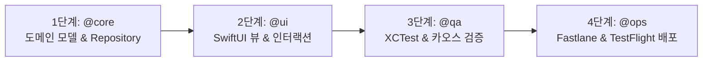

# Ghibli App Subagents Instructions & Routing System

이 문서는 Ghibli App (iOS / SwiftUI) 개발, 검증, 배포 전 과정에서 4종의 전문 서브에이전트(`@ui`, `@core`, `@qa`, `@ops`)를 효율적으로 라우팅하고 협업하도록 정의한 오케스트레이션 지침서입니다.

---

## 1. 서브에이전트 라우팅 테이블 (Routing Table)

사용자의 프롬프트에 특정 멘션(`@mention`)이 포함되거나 `/agent`로 에이전트가 선택된 경우, 해당 서브에이전트의 페르소나, 설계 원칙, 출력 형식을 **최우선 순위로 적용**합니다.

| 멘션 / 에이전트 | 에이전트 정의 파일 | 핵심 페르소나 및 역할 | 주요 책임 영역 (iOS / SwiftUI) |
| :--- | :--- | :--- | :--- |
| **`@ui`** (`ui`) | [`.agents/agents/ui.md`](file:///.agents/agents/ui.md) | **iOS UI/UX Specialist** (SwiftUI 렌더링 및 인터랙션) | • SwiftUI 선언형 뷰 최적화 (불필요한 body 재연산 방지) • 비즈니스 로직 철저 분리 • Apple HIG 최소 44x44pt 터치 영역 확보 • 스켈레톤(`.redacted`)/빈 상태(`ContentUnavailableView`)/에러 뷰 |
| **`@core`** (`core`) | [`.agents/agents/core.md`](file:///.agents/agents/core.md) | **iOS Domain & Architecture Specialist** (도메인 로직, UDF, 캐시 파이프라인) | • 불변 struct, `Sendable`, `Codable` 모델링 • 클린 아키텍처 DIP (Repository Protocol 분리) • Cache-First (로컬 캐시 우선 동기화) • Swift Concurrency (`async/await`, `actor`) 기반 동시성 안전성 |
| **`@qa`** (`qa`) | [`.agents/agents/qa.md`](file:///.agents/agents/qa.md) | **iOS QA & Chaos Specialist** (예외 주입 및 엣지 케이스 검증) | • 네트워크 타임아웃/오프라인 단절 주입 (`URLProtocol` Mock) • 초장문/일본어 원제/특수문자/이모지 레이아웃 스트레스 테스트 • 순환 참조(`[weak self]`) 및 메모리 누수 분석 • `XCTest` 및 `XCUITest` 자동화 테스트 작성 |
| **`@ops`** (`ops`) | [`.agents/agents/ops.md`](file:///.agents/agents/ops.md) | **Apple Platform Release Engineer** (CI/CD, 인증서 보안, TestFlight 배포) | • App Store Connect API Key 및 Match 인증서 보안 분리 • SPM 캐시 최적화 및 빌드 시간 단축 • Fastlane 기반 TestFlight/App Store 배포 자동화 • 빌드 실패 슬랙/웹훅 알림 연동 |

---

## 2. 4단계 풀스택 개발 & 배포 라이프사이클 (iOS Pipeline)

1. **Phase 1: `@core` (도메인 & 데이터 파이프라인)**
   - Ghibli API 응답 구조에 맞는 불변 Entity 모델링
   - 오프라인 캐시 우선 Repository Protocol 및 Actor 구현체 작성
   - `@Observable` 기반 ViewModel 구축
2. **Phase 2: `@ui` (프레젠테이션 & 인터랙션)**
   - `@core`의 상태를 바인딩하는 SwiftUI 뷰 계층 구조 구성
   - `.redacted(reason: .placeholder)` 스켈레톤 로딩, 빈 화면, 재시도 뷰 구현
   - 44x44pt 터치 영역 및 Dynamic Type(`@ScaledMetric`) 대응
3. **Phase 3: `@qa` (예외 주입 & 품질 검증)**
   - 네트워크 단절 및 비정상 응답 시의 방어 동작 검증
   - `XCTest` 단위 테스트 및 뷰 라이프사이클 복원성 테스트 작성
4. **Phase 4: `@ops` (빌드 자동화 & 릴리즈)**
   - `fastlane ios beta`를 통한 코드 서명 및 TestFlight 자동 배포
   - GitHub Actions 워크플로우를 통한 CI 빌드/테스트 자동화

---

## 3. 공통 기술 스택 및 빌드 컨벤션 (ghibliApp)

- **Language / Platform**: Swift, iOS (Xcode)
- **UI Framework**: SwiftUI
- **Architecture**: Clean Architecture, UDF (`@Observable`, Async/Await, Actor)
- **Data Modeling**: `Codable`, `Identifiable`, `Sendable` Struct
- **Testing**: `XCTest`, `XCUITest` (명령어: `swift test` 또는 `xcodebuild test`)
- **Automation**: Fastlane (`match`, `gym`, `testflight`), GitHub Actions
