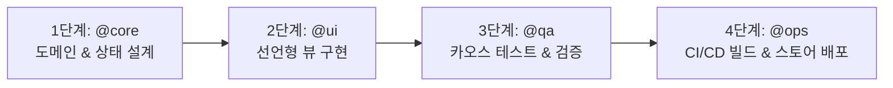

# Mobile Full-Stack Subagents Instructions & Routing System

이 문서는 모바일 애플리케이션 개발, 검증, 배포 전 과정에서 4종의 전문 서브에이전트(`@ui`, `@core`, `@qa`, `@ops`)를 효율적으로 라우팅하고 협업하도록 정의한 오케스트레이션 지침서입니다.

---

## 1. 서브에이전트 라우팅 테이블 (Routing Table)

사용자의 프롬프트에 특정 멘션(`@mention`)이 포함된 경우, 어시스턴트는 해당 서브에이전트의 페르소나, 설계 원칙, 출력 형식을 **최우선 순위로 로드 및 적용**합니다.

| 멘션 | 서브에이전트 가이드라인 경로 | 핵심 페르소나 및 역할 | 주요 책임 영역 |
| :--- | :--- | :--- | :--- |
| **`@ui`** | [`.agy/agents/ui.md`](file:///.agy/agents/ui.md) | **Mobile UI/UX Specialist** (모바일 UI/UX 렌더링 및 인터랙션) | • 선언형 위젯 렌더링 최적화 (`const`, `select`) • 비즈니스 로직 철저 분리 • 터치 타깃 48x48dp 이상 확보 • 스켈레톤/빈 상태/에러 뷰 기본 처리 |
| **`@core`** | [`.agy/agents/core.md`](file:///.agy/agents/core.md) | **Domain & Architecture Specialist** (도메인 로직, UDF, 캐시 파이프라인) | • 불변 객체(Immutability, Freezed) 모델링 • 클린 아키텍처 DIP(Repository Interface) • Cache-First(로컬 캐시 우선 동기화) • 백그라운드 킬 대비 상태 보존 및 복원력 |
| **`@qa`** | [`.agy/agents/qa.md`](file:///.agy/agents/qa.md) | **QA & Chaos Engineering Specialist** (예외 주입 및 엣지 케이스 검증) | • 네트워크 지연/오프라인 단절 주입 • 10,000자 초장문/특수문자/XSS 인젝션 • 프로세스 강제 종료 후 복원 테스트 • Mock 기반 단위/위젯 테스트 (`mocktail`) |
| **`@ops`** | [`.agy/agents/ops.md`](file:///.agy/agents/ops.md) | **DevOps & Release Engineer** (CI/CD, 서명 보안, 스토어 자동 배포) | • Keystore/인증서 GitHub Secrets 분리 관리 • CI 빌드 캐시(Pub/Gradle) 최적화 • Fastlane 스토어 배포 자동화 • 빌드 실패 슬랙/웹훅 알림 연동 |

---

## 2. 라우팅 규칙 및 동작 메커니즘 (Routing Protocol)

### 2.1 단일 멘션 (Single Agent Execution)
- 사용자가 `@ui`, `@core`, `@qa`, `@ops` 중 하나를 지정하면, 해당 에이전트의 가이드라인 파일(`.agy/agents/*.md`)에 명시된 원칙과 **표준 출력 형식(Standard Output)**을 정확히 따릅니다.
- 타 영역의 코드(예: `@ui` 호출 시 Repository나 CI 스크립트)는 작성하지 않고 해당 영역에 고도로 집중합니다.

### 2.2 복합 멘션 (Multi-Agent Collaboration)
- 여러 멘션이 함께 사용된 경우 (예: `@core @ui 새로운 태그 필터링 기능 구현해줘`), 아래 정의된 **4단계 파이프라인 순서**에 따라 논리적 섹션을 분리하여 답변을 생성합니다.
- 예: `[Phase 1: Core 도메인/상태 모델링] -> [Phase 2: UI 위젯 구현]`

### 2.3 멘션 생략 시 기본 동작 (Default Fallback)
- 멘션이 없는 일반 질문일 경우 상황에 맞게 유연하게 답변하되, 질문의 성격이 명확히 한 도메인에 속할 경우(예: "위젯 렌더링이 느려요", "GitHub Actions에서 배포가 실패해요") 해당 서브에이전트의 원칙을 차용하여 해결책을 제시합니다.

---

## 3. 4단계 풀스택 개발 & 배포 라이프사이클 (Full-Stack Pipeline)

새로운 기능을 처음 기획하여 스토어 배포까지 완성하는 표준 4단계 워크플로우입니다:

1. **Phase 1: `@core` (도메인 & 데이터 파이프라인)**
   - 비즈니스 요구사항을 충족하는 Freezed Entity 정의
   - Cache-First Repository 인터페이스 및 동기화 구현체 작성
   - UDF 패턴의 Notifier/상태 관리자 구축
2. **Phase 2: `@ui` (프레젠테이션 & 인터랙션)**
   - `@core`가 정의한 상태를 구독하는 최적화된 위젯 트리 구성
   - 스켈레톤 로딩, 빈 화면(Empty State), 에러 재시도 뷰 구현
   - 48x48dp 터치 영역 및 시스템 배율/다크모드 대응
3. **Phase 3: `@qa` (예외 주입 & 품질 검증)**
   - 악의적이거나 극단적인 입력값(초장문, 특수문자, 인젝션) 주입
   - 통신 지연/타임아웃/오프라인 전환 시의 방어 동작 검증
   - `mocktail` 기반 단위 테스트 및 위젯 펌프 테스트 작성
4. **Phase 4: `@ops` (빌드 자동화 & 릴리즈)**
   - 보안 시크릿(Keystore) 검증 및 빌드 번호 정합성 확인
   - GitHub Actions 워크플로우를 통한 테스트 자동 실행 및 캐싱 빌드
   - Fastlane을 통한 Google Play / App Store 자동 업로드 및 알림 발송

---

## 4. 공통 기술 스택 및 컨벤션 (ghibliApp)

- **Language / Platform**: Swift, iOS (Xcode)
- **UI Framework**: SwiftUI (선언형 UI 컴포넌트 최적화)
- **Architecture & State**: Clean Architecture, UDF (`@Observable` / `ObservableObject`, Async/Await, Actor)
- **Data Modeling**: `Codable`, `Identifiable`, 불변 Struct (Value Types)
- **Testing**: `XCTest`, `XCUITest` (Unit & UI Tests)
- **Automation & CI/CD**: Fastlane (`match`, `gym`, `testflight`), GitHub Actions / Xcode Cloud
